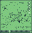
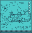
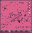

# Ti60F225 control card

An FPGA control card for the tube_power_5_1 power board, built around an Efinix Titanium Ti60F225C4, designed in
KiCad 10. It is a conversion of the Agilex 3 control card (`~/dev/ti60f225_control_card`, GitHub
`agilex3_control_card`): same outline, 2×25 1.27 mm power-board header and JTAG header positions.

**Status: phase 4 of the conversion done (2026-10-30).** The schematic is converted to the Ti60F225 (ERC clean,
netlist checked by `tools/check_schematic.py`), and its FPGA ball assignment passes Efinity's Interface Designer
check and a stub compile with SPI active x4 (`efinity/pinplan/run.sh --compile`, `reference/pin_assignment.csv`). The board
(`hardware/control_card.kicad_pcb`) is still the Agilex 3 layout. Plan, decisions and remaining steps:
[`CONVERSION_PLAN.md`](CONVERSION_PLAN.md); device requirements: [`docs/ti60_requirements.md`](docs/ti60_requirements.md).

## Board

Copper layers of `hardware/control_card.kicad_pcb`, plotted by GitHub Actions on every board change
([kicad-board-plots](https://github.com/johonkanen/kicad-board-plots)).

<!-- board-plots:start -->
<!-- Generated by kicad-board-plots; edits between these markers are overwritten. -->

Copper layers of `hardware/control_card.kicad_pcb` in stack order, without silkscreen. Plotted by [kicad-board-plots](https://github.com/johonkanen/kicad-board-plots) on each board change; the images live on the `renders` branch.

<table>
<tr>
<td align="center"> <b>F.Cu: signal (top)</b></td>
<td align="center"> <b>In1.Cu: GND plane</b></td>
</tr>
<tr>
<td align="center"> <b>In2.Cu: signal, +1V8 pour</b></td>
<td align="center"> <b>In3.Cu: +0V95, +3V3 planes</b></td>
</tr>
<tr>
<td align="center"> <b>In4.Cu: GND plane</b></td>
<td align="center"> <b>B.Cu: signal, SW_3V3, SW_1V8, +0V95, GND, SW_0V95 and 3 more pours (bottom, seen from the top)</b></td>
</tr>
</table>

<!-- board-plots:end -->

## Repository layout

| Path | Contents |
|---|---|
| `hardware/` | KiCad project (`control_card.kicad_pro`), sheets, project libraries, JLCPCB design rules |
| `reference/ti60f225_pinout.csv` | All 225 Ti60F225 balls: pad, bank, HVIO/HSIO type, configuration function, LVDS pair, clock region |
| `reference/` | Power-board header pinout, ADC mux channel table, JLC part cache, the Agilex pin list (for net names) |
| `docs/` | JLCPCB production checklist |
| `tools/jlc/` | Submodule [jlc-tools](https://github.com/johonkanen/jlc-tools): JLC part search, stock check, BOM/CPL and Gerber export |

Clone with `git clone --recursive`, or run `git submodule update --init` after cloning.

## License

[MIT](LICENSE).
